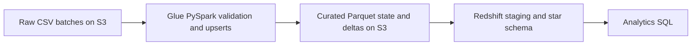

# E-commerce Analytics Data Platform

A batch data engineering project for five transactional sources. The same PySpark script runs locally and as an AWS Glue Spark job.



## Execution status

The local demo passed using PySpark 3.5.4, Java 17 and DuckDB 2.0.0. AWS Glue execution and the Redshift COPY statements still require validation in an AWS account. No cloud performance or production deployment results are claimed.

Repository files include the Spark transformation, warehouse SQL generator, two input batches, analytics SQL, local verification and scoped IAM policy templates.

## Run the demo locally

Use Python 3.11 or 3.12 and Java 17. From this folder:

```bash
python -m venv .venv
# Activate with source .venv/bin/activate on macOS/Linux
# Activate with .venv\Scripts\Activate.ps1 in Windows PowerShell
python -m pip install -r requirements.txt
python demo.py
```

The demo runs the actual Spark transformation, writes temporary Parquet files, and loads the deltas into DuckDB with the same staging and transactional upsert logic used by the Redshift SQL generator. It checks these outcomes:

| Scenario | Expected result |
|---|---|
| Initial load | 3 sales lines and 70.00 in booked revenue |
| Incremental load | 3 changed sales lines staged, 4 total warehouse sales lines, and 180.00 in booked revenue |
| Older source update | Product 1 stock stays at 10 despite the incoming stale value of 99 |
| Exact duplicate and warehouse replay | 4 unique sales lines and 180.00 in booked revenue |
| Payment attempts | 3 successes out of 4 attempts |
| Batch ordering | A skipped or older warehouse batch fails without changing totals |

## Model and grain

| Table | Grain and key |
|---|---|
| `dim_customer` | One current row per `customer_id` |
| `dim_product` | One current row per `product_id`, including current stock |
| `dim_date` | One observed calendar date per integer `date_key` |
| `dim_location` | One shipping city/state pair per deterministic `location_key` |
| `fact_sales` | One line per `order_item_id`, retaining `order_id` for order-level grouping |
| `fact_payment` | One attempt per `payment_id`, retaining `order_id` |

Use `COUNT(DISTINCT order_id)` for order counts. Joining sales and payments directly by order can multiply both measures when an order has multiple items and attempts. Aggregate each fact to order grain first if comparing those measures. Customer and product attributes use Type 1 updates. The model assumes a single currency. Revenue here means line amounts for completed orders, independent of payment settlement.

## Incremental behavior

- Each numbered raw batch contains one CSV per source, with matching headers and UTC `updated_at` values. Use a header-only file when a source has no changes. Treat inputs as immutable and submit complete row images for updates.
- Each source's previous Parquet state is combined with the current CSV. The newest timestamp wins per key. Exact duplicates collapse, and conflicting versions at an identical timestamp fail the batch. The job checks required fields, numeric ranges and references before writing results.
- Spark rebuilds the model from current source state and writes rows that differ from the previous model to per-table delta prefixes. An order status change propagates to existing sales lines even if their item records did not change. This keeps warehouse writes incremental while scanning the full current state in Spark.
- Redshift stages each delta and replaces matching keys in one transaction with a load ledger. Replaying the latest immutable batch is safe. The ledger rejects skipped and older batches. Physical source deletes are outside this demo's scope. Represent an order cancellation as a status update. Historical date and location keys remain available in the warehouse.
- Run one batch at a time. Advance after Glue reports success and the warehouse transaction commits. If Glue fails, rerun that batch from the same immutable input before publishing or advancing. If the warehouse load fails, roll back and rerun the same SQL. The Spark output prefixes are work products until Glue succeeds.

## Run on AWS

1. Use an existing S3 bucket and Redshift database in the same AWS Region. Give the Glue job role read access to the script and raw prefixes and read/write/delete access to the curated prefix. Associate a separate Redshift role with read access to the curated prefix. The SQL user needs privileges to create and write the analytics objects.
2. Upload the sample inputs and Spark script. Replace `your-bucket` with your bucket name.

   ```bash
   aws s3 cp sample/raw/ s3://your-bucket/ecommerce/raw/ --recursive
   aws s3 cp pipeline.py s3://your-bucket/ecommerce/scripts/pipeline.py
   ```

3. Create a Glue 5.0 Spark job with that script location, the Glue IAM role, job bookmarks disabled, and concurrency set to one. Pass these job parameters for the initial run, then change `--batch` to `2` for the incremental run.

   | Parameter | Value |
   |---|---|
   | `--raw` | `s3://your-bucket/ecommerce/raw` |
   | `--curated` | `s3://your-bucket/ecommerce/curated` |
   | `--batch` | `1` |

4. After each successful Glue run, generate the matching SQL file. Execute the entire file in a single Redshift session and stop on the first SQL error. Repeat with `--batch 2` and `load-2.sql` after the first load commits.

   ```bash
   python warehouse.py --batch 1 --curated s3://your-bucket/ecommerce/curated --redshift-role arn:aws:iam::123456789012:role/RedshiftCuratedReader > load-1.sql
   ```

5. Run `analytics.sql` after each warehouse load. Capture the Glue job status, the Redshift load ledger and the revenue output. Replay batch 2's warehouse SQL and verify that the row counts and revenue stay the same.

AWS references: [Glue runtimes](https://docs.aws.amazon.com/glue/latest/dg/release-notes.html) and [Redshift Parquet COPY](https://docs.aws.amazon.com/redshift/latest/dg/copy-usage_notes-copy-from-columnar.html).

## IAM setup

The JSON files in `aws/` are templates. Replace `YOUR_BUCKET` with your S3 bucket name before creating the policies.

1. Create a role trusted by Glue using `aws/glue-trust.json`.
2. Attach the AWS managed `AWSGlueServiceRole` policy for Glue service operations and logging, then attach the bucket policy in `aws/glue-s3-policy.json`.
3. Create a second role using `aws/redshift-trust.json` and attach `aws/redshift-s3-policy.json`.
4. Associate that second role with the Redshift namespace or cluster. Pass its ARN to `warehouse.py`.

Keep the script at `scripts/pipeline.py`, raw inputs at `raw/0001/` and `raw/0002/`, and outputs under `curated/`. Configure the Glue job's temporary directory under `curated/temp/` if needed. The policy templates use those prefixes. Keep S3 and Redshift in the same Region.

## Verification and interview discussion

See [VALIDATION.md](VALIDATION.md) for checked results, remaining AWS checks and the implementation's scaling limits.
